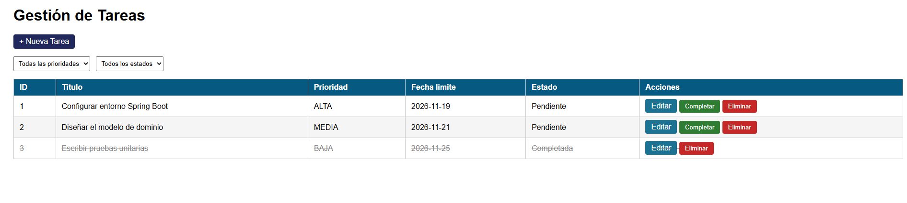
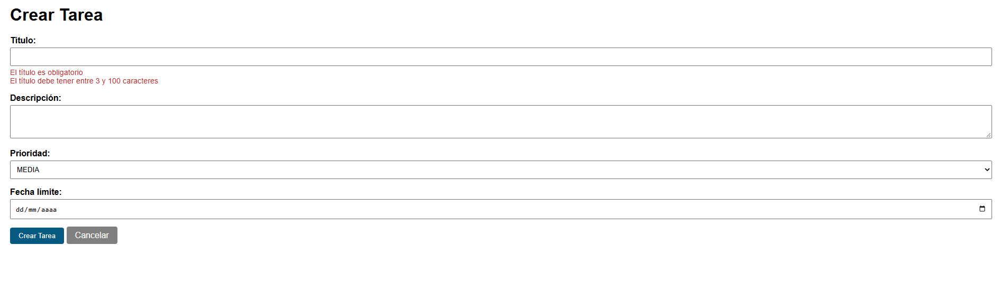
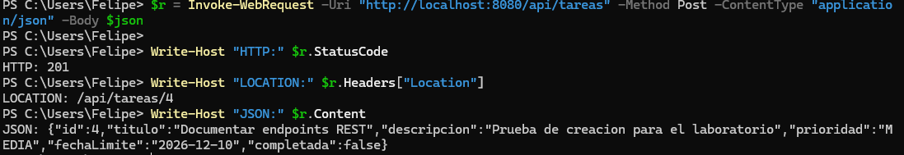
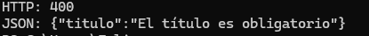

# Post-contenido — Unidad 7: Gestión de Tareas con Spring Boot

## Descripción
Repositorio del laboratorio de la Unidad 7 de Programación Web — Séptimo Semestre.

Un único proyecto Spring Boot con dos capas sobre el mismo TareaService: una vista Thymeleaf (@Controller, Parte 1) y una API REST (@RestController, Parte 2).

## Parte 1 — Vista Thymeleaf con @Controller
TareaController expone /tareas con filtrado por @RequestParam (prioridad y completada), formularios validados con @Valid y BindingResult, y acciones de completar y eliminar mediante POST.

## Parte 2 — API REST con @RestController
TareaApiController expone /api/tareas con los métodos GET, POST, PUT, PATCH y DELETE.

Ambos controladores utilizan la misma instancia de TareaService.

ApiErrorHandler utiliza @RestControllerAdvice para devolver errores de validación en formato JSON con código 400 Bad Request.

## Endpoints de la API

| Método | URL | Código de éxito | Código de error |
|---|---|---|---|
| GET | /api/tareas | 200 OK | — |
| GET | /api/tareas/{id} | 200 OK | 404 |
| POST | /api/tareas | 201 Created | 400 |
| PUT | /api/tareas/{id} | 200 OK | 400 / 404 |
| PATCH | /api/tareas/{id}/completar | 200 OK | 404 |
| DELETE | /api/tareas/{id} | 204 No Content | 404 |

## Decisiones de diseño
- Inyección por constructor en ambos controladores para facilitar las pruebas y hacer explícitas las dependencias.
- @FutureOrPresent en lugar de @Future para permitir tareas con vencimiento el mismo día.
- POST en lugar de GET para completar y eliminar tareas desde Thymeleaf, evitando modificaciones mediante peticiones de lectura.
- PATCH en lugar de PUT para completar tareas, porque solo modifica un campo.
- BindingResult para validación HTML y @RestControllerAdvice para errores JSON.
- Persistencia en memoria mediante Map en TareaService, sin JPA/Hibernate, que se introduce en la Unidad 8.

## Cómo compilar y ejecutar
1. Clonar el repositorio: `git clone https://github.com/pipevilla423/villamizar-post2-u7.git`
2. Abrir el proyecto Maven en VS Code o IntelliJ IDEA.
3. Ejecutar `.\mvnw.cmd spring-boot:run` en Windows.
4. Vista web: http://localhost:8080/tareas
5. API REST: http://localhost:8080/api/tareas

## Capturas de pantalla

